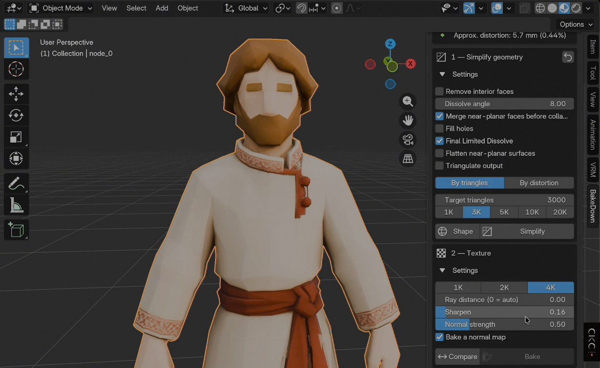
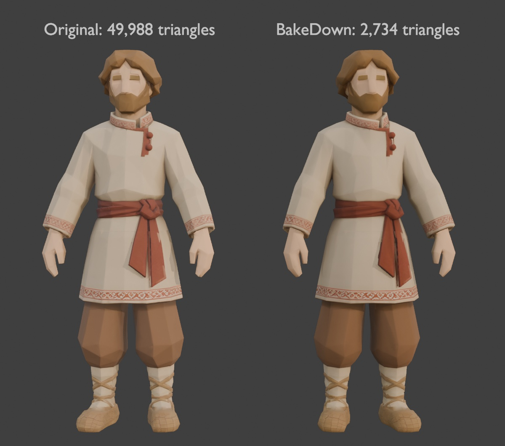
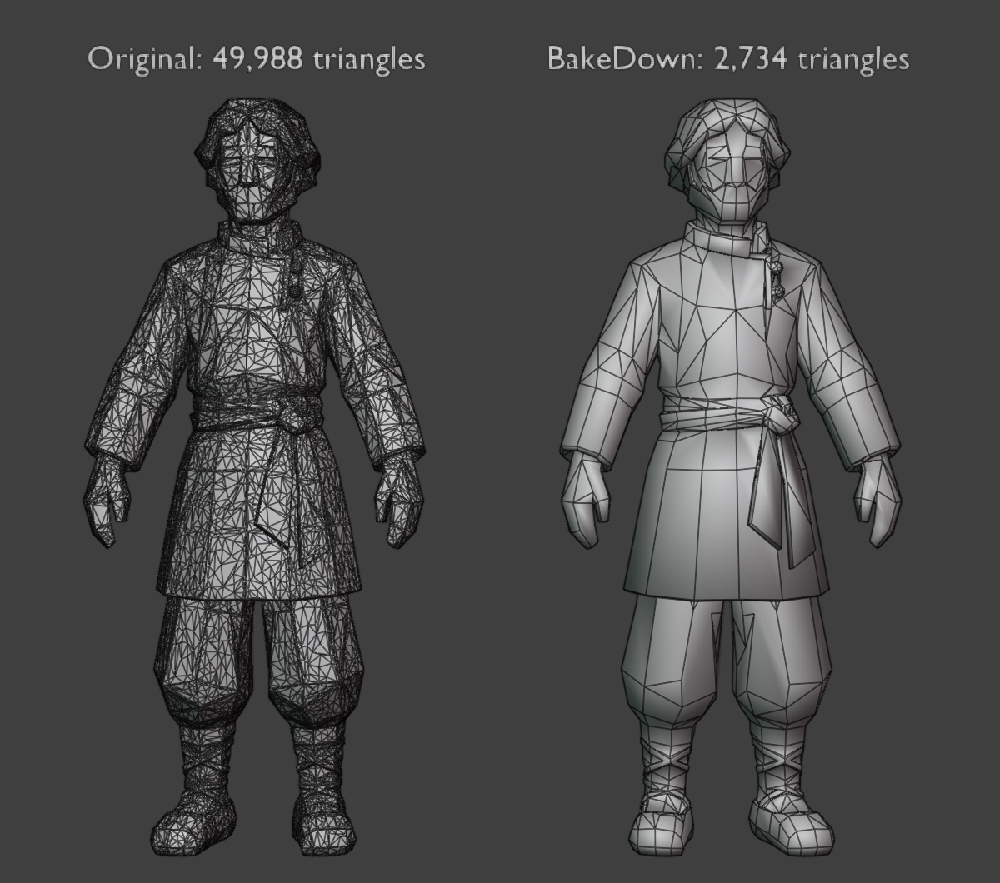
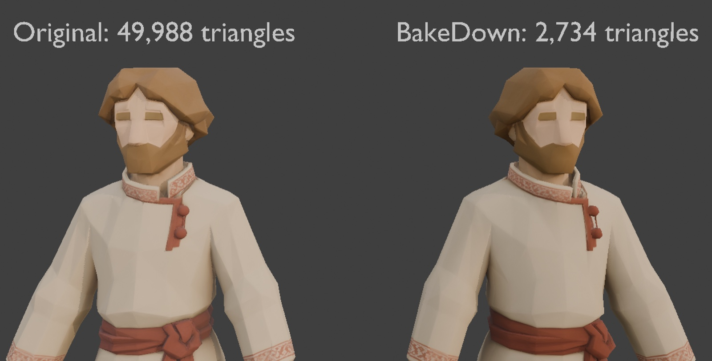
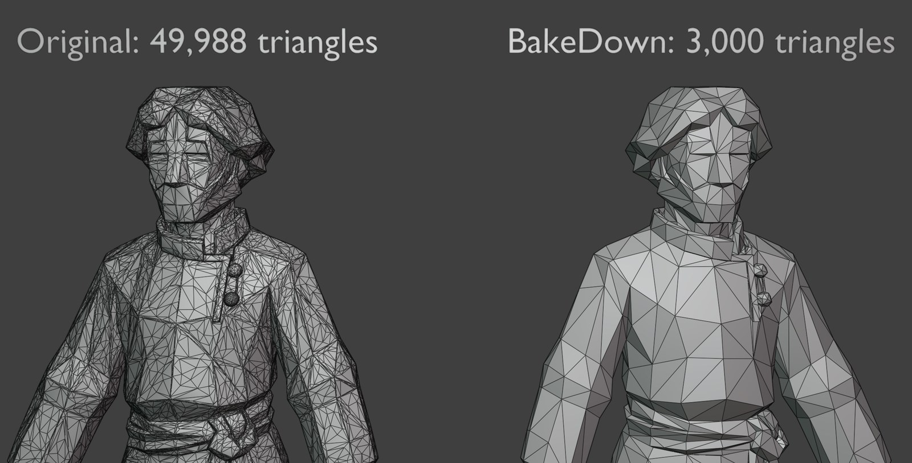

# BakeDown

[English](README.md) · [Русский](README.ru.md) · [Español](README.es.md) · **Deutsch** · [简体中文](README.zh-CN.md)

**Version 1.3.0 · Blender 4.5+ · GPL-3.0-or-later**

BakeDown ist ein Blender-Add-on, das schwere KI-generierte und Photogrammetrie-Meshes (Hunyuan, Meshy, Tripo, Rodin, Scans — oft 50k+ Polygone mit einer einzigen 4K-Textur) in **spielfertige Assets** verwandelt. Es vereinfacht nur das aktive Mesh, backt PBR-Texturen vom Original auf das leichte Mesh, erzeugt LODs, überträgt Rigs und exportiert nach Unity, Unreal Engine oder glTF.

Der Ablauf ist **nicht-destruktiv**: Das Original bleibt als Sicherung erhalten, Werte lassen sich frei ausprobieren, und **Zurücksetzen** stellt alles wieder her.

Autor: **Kirill Migachev**

[](docs/media/bakedown_demo.mp4)

▶ **[40-Sekunden-Demo ansehen](docs/media/bakedown_demo.mp4)**

### Gleiches Aussehen, 95 % weniger Dreiecke

| Ganze Figur, texturiert | Ganze Figur, Drahtgitter |
|---|---|
|  |  |
| **Nahaufnahme, texturiert** | **Nahaufnahme, Drahtgitter** |
|  |  |

Original (links) und BakeDown-Ergebnis (rechts): 49.988 → 2.734 Dreiecke, ca. 7,3 mm Verzerrung (0,56 %), 4K-Baking.

## Installation

1. `bakedown.py` aus dem [neuesten Release](https://github.com/keeraa/bakedown/releases/latest) herunterladen.
2. In Blender: **Edit → Preferences → Add-ons → Install from Disk…** und `bakedown.py` auswählen.
3. **BakeDown — Game Asset Optimizer** aktivieren.
4. Die Seitenleiste der 3D-Ansicht mit **N** öffnen und den Reiter **BakeDown** wählen.

Zum Aktualisieren die neue `bakedown.py` über die alte installieren und Blender neu starten.

## Arbeitsablauf

Statisches Objekt (Gebäude, Requisite):

```text
Vereinfachen → Backen → (LOD) → Exportieren
```

Charakter:

```text
Vereinfachen → Backen → Rig → LOD → Exportieren
```

LODs **nach** dem Rig erzeugen, damit sie das Skelett übernehmen. Sind mehrere Objekte ausgewählt, bearbeitet BakeDown nur das aktive Mesh (das mit dem helleren Umriss).

## Funktionen

### Vereinfachung
- Ziel nach echter Dreiecksanzahl (Regler + Voreinstellungen 1K/3K/5K/10K/20K) oder nach ungefährem Verzerrungsbudget (eine binäre Suche ermittelt die Dreiecksanzahl).
- Verschweißen, Bereinigen loser Geometrie, Normalen-Korrektur (inklusive Custom Split Normals von KI-Meshes), Limited Dissolve und Collapse-Decimate; optional Löcher füllen, Innenflächen entfernen, Flächen begradigen und explizit triangulieren.
- Verzerrungsschätzung in Millimetern und % der Objektgröße direkt im Panel.
- Prüfansicht **Form** (Solid + MatCap + Drahtgitter) und **Vergleichen** Original ↔ Ergebnis.

### Textur-Baking
- Cycles-Baking von Base Color, Roughness, Metallic und optional einer Tangent-Space-Normal-Map auf ein neues UV-Layout, in 1K/2K/4K.
- Modal, mit Fortschritt und Abbruch; vollständiges Zurückrollen bei Abbruch oder Fehler.
- Automatische Strahldistanz, Live-Normal-Stärke, Schärfen der Base Color.

### LOD
- LOD0–LOD3 mit den Voreinstellungen Strategie, 3D-Shooter, Mobil und Eigene. Alle LODs teilen sich einen Textursatz.
- Skelett-bewusst: LODs eines geriggten Meshes übernehmen Skelett und Gewichte.
- Benennung `<Objekt>_LOD0..3`, sodass Unity automatisch eine LOD Group erstellt.
- Warnt, wenn LODs nach erneutem Vereinfachen oder Backen veraltet sind, und verweigert deren Export.

### Rig-Übertragung
- Ein geskinntes FBX als Vorlage importieren und Skelett und Vertex-Gewichte auf das aktive Mesh übertragen (für ähnliche Humanoide).
- Arbeitet in der Rest Position und stellt den Posen-Zustand auch nach einem Fehler wieder her.

### Export
- FBX für Unity, FBX für Unreal (Smoothing Groups) und eigenständiges GLB.
- Modell und PNG-Texturen landen in einem Unterordner mit dem Namen der .blend-Datei; das FBX verweist mit relativen Pfaden auf die PNGs.
- Optionen: Grünkanal der Normal Map invertieren (DirectX-Konvention), ORM packen.
- Exportiert ein einzelnes Objekt oder seine gesamte LOD-Collection (mit Skelett) als eine Datei.

## Sprachen der Oberfläche

Die Originalsprache der Oberfläche ist Englisch. Übersetzungen für **Russisch, Spanisch, Deutsch und vereinfachtes Chinesisch** sind enthalten; Blender zeigt sie automatisch passend zur Oberflächensprache an (**Preferences → Interface → Translation**).

## Tipps

- Gebacken wird mit Cycles auf der CPU: in 4K zwischen einigen Dutzend Sekunden und ein paar Minuten pro Objekt.
- Schwarze Flecken nach dem Backen → **Strahldistanz** erhöhen; verschmierte feine Details → wieder auf 0 (auto) setzen.
- Triangulierung ist standardmäßig aus: Engines triangulieren beim Import, die GPU-Last ist gleich.
- Für Mixamo-Animationen: einmal riggen; Animationen sind separate FBX-Dateien, die in Unity per Humanoid Avatar retargetet werden.

## Einschränkungen

- Die Verzerrung ist eine ungefähre, abgetastete Metrik, keine exakte Hausdorff-Distanz.
- Ein laufender Backdurchgang lässt sich nicht unterbrechen; der Abbruch greift zwischen den Maps.
- Die Innenflächen-Erkennung ist experimentell und standardmäßig aus.
- Ungewöhnliche negative oder ungleichmäßige Skalierungen vor dem Engine-Import prüfen.

## Entwicklung

Architektur und Stolperfallen stehen in [docs/DEVELOPMENT.md](docs/DEVELOPMENT.md) (Englisch), der Teststatus in [docs/VERIFICATION.md](docs/VERIFICATION.md). Tests ohne Oberfläche:

```bash
/Applications/Blender.app/Contents/MacOS/Blender -b --factory-startup --python-exit-code 1 --python tests/run_tests.py
```

## Lizenz

GNU General Public License v3.0 oder später. Siehe [LICENSE](LICENSE).
