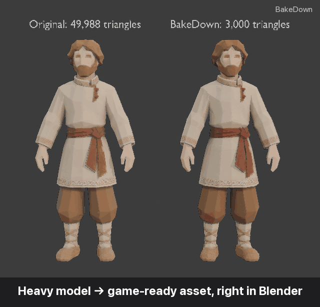
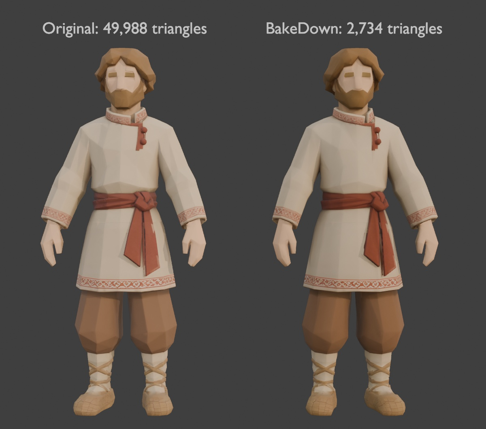
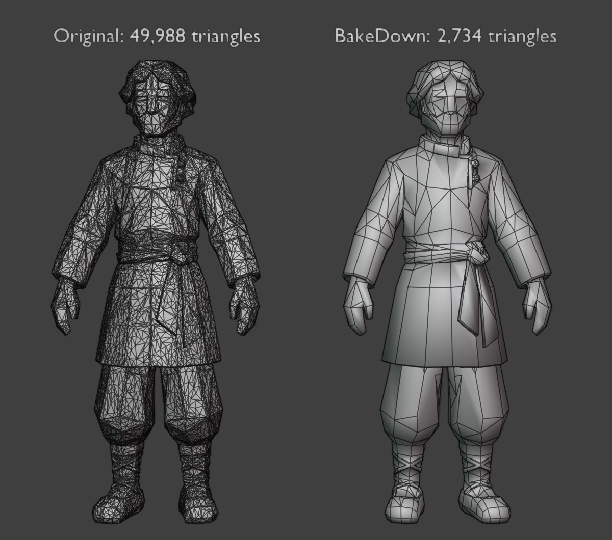
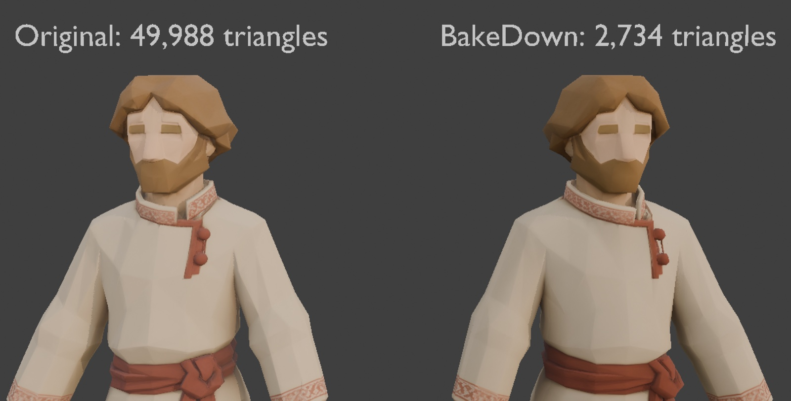
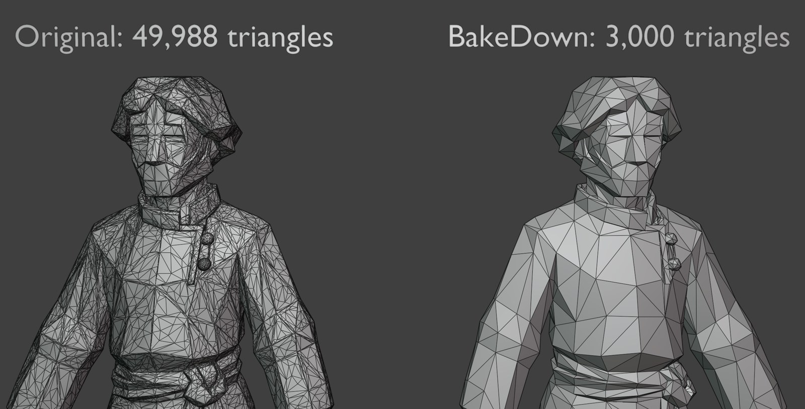

<div align="center">

# BakeDown

**Modelos 3D pesados → assets listos para juegos, directamente en Blender.**

[English](README.md) · [Русский](README.ru.md) · **Español** · [Deutsch](README.de.md) · [简体中文](README.zh-CN.md)

[](https://www.blender.org/download/)
[](https://github.com/keeraa/bakedown/releases/latest)
[](https://github.com/keeraa/bakedown/actions/workflows/tests.yml)
[](LICENSE)
[](#idiomas-de-la-interfaz)
[](AGENTS.md)



**−95 % de triángulos · el mismo aspecto · texturas PBR horneadas en segundos**

[**⬇ Descargar**](https://github.com/keeraa/bakedown/releases/latest) · [▶ Demo de 40 segundos](docs/media/bakedown_demo.mp4) · [🤖 Para agentes de IA](AGENTS.md) · [❓ Preguntas frecuentes](docs/FAQ.md)

</div>

---

BakeDown es un complemento gratuito de Blender que convierte **cualquier malla pesada** —generada por IA (Hunyuan, Meshy, Tripo, Rodin), escaneos 3D, esculturas, modelos high-poly de tiendas o kitbash— en un asset ligero, texturizado y listo para juegos. Simplifica la malla, hornea sobre ella las texturas del original, crea LOD, transfiere rigs y exporta a Unity, Unreal Engine o glTF. No destructivo: el original se conserva y **Restablecer** lo recupera.

## Inicio rápido

1. **Descarga** `bakedown.py` de la [última versión](https://github.com/keeraa/bakedown/releases/latest).
2. En Blender: **Edit → Preferences → Add-ons → Install from Disk…**, elige `bakedown.py` y activa **BakeDown — Game Asset Optimizer**.
3. Selecciona tu modelo, pulsa **N** y abre la pestaña **BakeDown**: **Simplificar → Hornear → Exportar**.

Personajes: **Simplificar → Hornear → Rig → LOD → Exportar** (los LOD creados después del rig heredan el esqueleto).

## Por qué BakeDown

| | A mano en Blender | **BakeDown** |
|---|---|---|
| Conservar el original y deshacerlo todo | duplicar y controlarlo tú | ✅ copia automática, **Restablecer** con un clic |
| Elegir el resultado | adivinar el ratio de Decimate | ✅ objetivo en triángulos **o** en error de forma permitido, en mm y % |
| Limpiar mallas de IA o escaneos | soldar, sueltos, normales, split normals a mano | ✅ integrado en **Simplificar** |
| Mantener el aspecto | configurar 4 horneados selected-to-active, UV y materiales | ✅ Base Color, Roughness, Metallic y Normal en un clic, reversión al cancelar |
| LOD | duplicar, diezmar, reasignar rig, renombrar | ✅ preajustes LOD0–LOD3, texturas compartidas, esqueleto incluido, aviso de LOD desactualizados |
| Exportar al motor | recordar ejes, escala, suavizado, formato de normales | ✅ preajustes Unity / Unreal / glTF |
| Automatización | escribir y depurar scripts `bpy` | ✅ API de Python y línea de comandos con informe JSON |

Un personaje de 50.000 triángulos pasa a 2.700 con horneado PBR 2K, cuatro LOD y un FBX para Unity en **unos 5 segundos**.

## Compara tú mismo

| Con texturas | Malla |
|---|---|
|  |  |
|  |  |

Original (izquierda) frente a BakeDown (derecha): 49.988 → 2.734 triángulos, distorsión aprox. 7,3 mm (0,56 %), horneado 4K.

## Qué incluye

- **Simplificar** — objetivo en triángulos reales o en margen de distorsión, limpieza de mallas de IA y escaneos, disolución de caras planas, colapso; opcionalmente relleno de agujeros, eliminación de caras interiores, aplanado y triangulación. Solo se modifica la malla activa.
- **Hornear** — horneado en Cycles de Base Color, Roughness, Metallic y Normal tangente sobre un nuevo despliegue UV a 1K/2K/4K; distancia de rayo automática, intensidad de normales en vivo, nitidez; progreso, Esc para cancelar, reversión completa.
- **LOD** — LOD0–LOD3 con preajustes Estrategia / Shooter 3D / Móvil / Personalizado, un único juego de texturas, compatible con esqueletos, nombres `_LOD0…3` para LOD Groups de Unity.
- **Transferencia de rig** — importa una plantilla FBX con skinning y transfiere esqueleto y pesos a la malla activa.
- **Exportar** — FBX para Unity, FBX para Unreal, GLB autónomo; mapas PNG junto al modelo, empaquetado ORM, normales en formato DirectX para Unreal.
- **Inspeccionar** — modo Forma (MatCap + malla de alambre) y Comparar original ↔ resultado.

## Uso con agentes de IA

Los agentes de IA (Claude, ChatGPT, Codex, Blender MCP…) pueden manejar BakeDown en lugar de improvisar su propio código de Blender; en las pruebas del autor esto dio assets claramente mejores. Ambos puntos de entrada devuelven un informe JSON (triángulos, distorsión, mapas horneados, LOD, archivos exportados):

```bash
blender -b --factory-startup --python tools/bakedown_cli.py -- model.glb --out ./out --triangles 3000 --resolution 2048 --engine unity
```

```python
import bakedown
report = bakedown.process(obj, triangles=3000, resolution=2048, export_dir="/tmp/out", engine="UNITY")
```

Instrucciones para agentes: [AGENTS.md](AGENTS.md) (en inglés).

## Idiomas de la interfaz

Inglés, ruso, español, alemán y chino simplificado; Blender cambia automáticamente con **Preferences → Interface → Translation**.

## Preguntas frecuentes

Objetivos de triángulos, distorsión, manchas negras tras hornear, personajes con rig, particularidades de Unity y Unreal y limitaciones: [docs/FAQ.md](docs/FAQ.md) (en inglés).

## Contribuir

Los informes de errores y las ideas son bienvenidos: [abre un issue](https://github.com/keeraa/bakedown/issues/new/choose). Para desarrolladores: [CONTRIBUTING.md](CONTRIBUTING.md), [docs/DEVELOPMENT.md](docs/DEVELOPMENT.md), [docs/VERIFICATION.md](docs/VERIFICATION.md), [CHANGELOG.md](CHANGELOG.md).

## Licencia

GPL-3.0-or-later © Kirill Migachev. Consulta [LICENSE](LICENSE).
