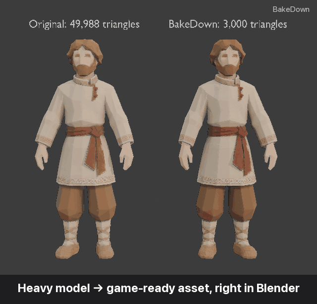
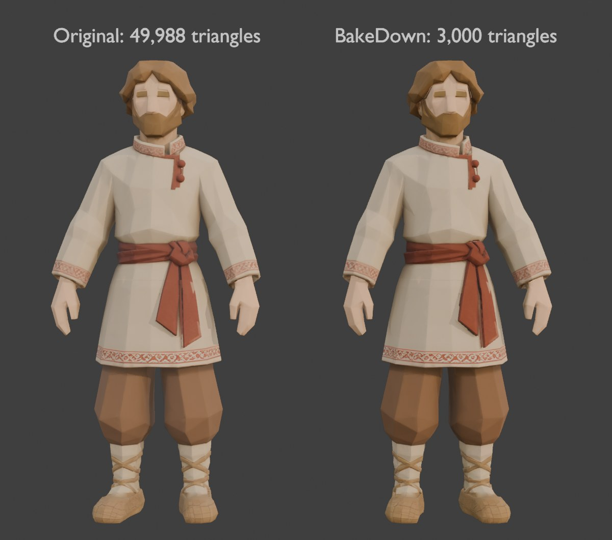
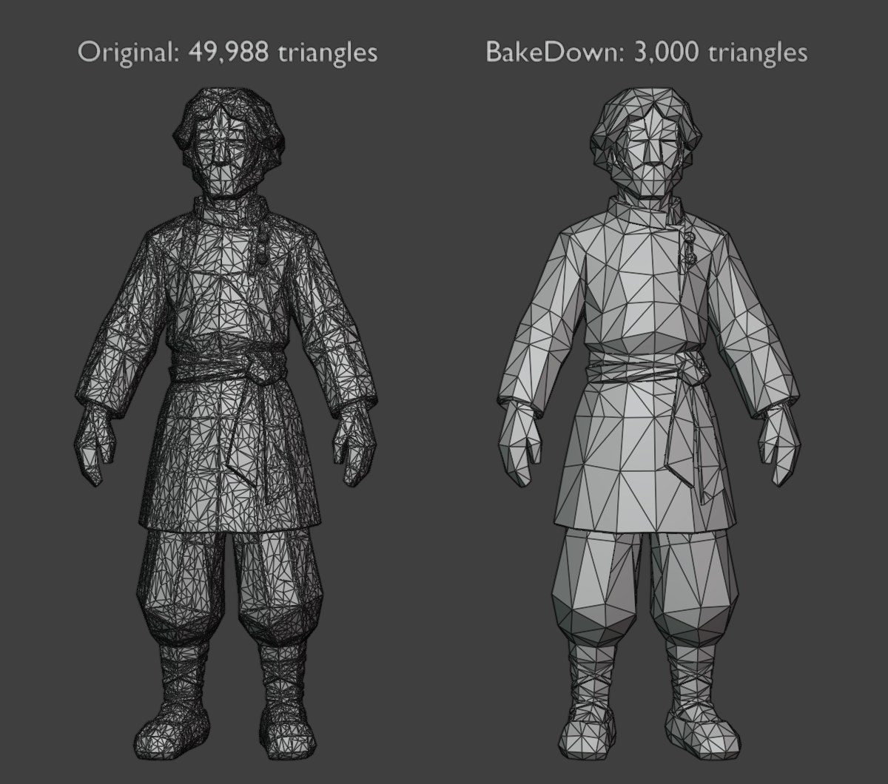
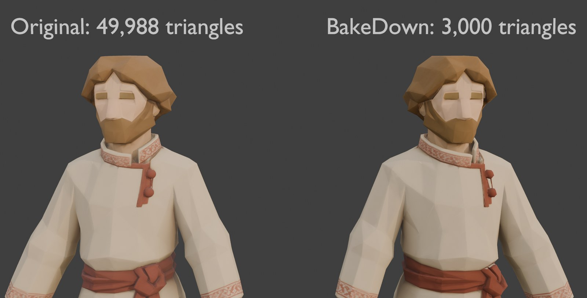
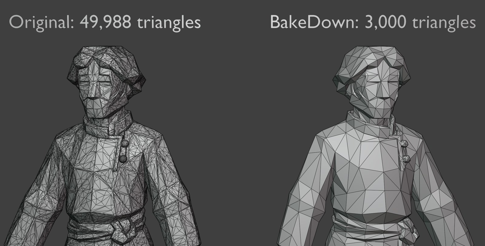

<div align="center">

# BakeDown

**Heavy 3D models → game-ready assets, right in Blender.**

**English** · [Русский](README.ru.md) · [Español](README.es.md) · [Deutsch](README.de.md) · [简体中文](README.zh-CN.md)

[](https://www.blender.org/download/)
[](https://github.com/keeraa/bakedown/releases/latest)
[](https://github.com/keeraa/bakedown/actions/workflows/tests.yml)
[](LICENSE)
[](#interface-languages)
[](AGENTS.md)



**−94% triangles · same look · PBR textures baked in seconds**

[**⬇ Download**](https://github.com/keeraa/bakedown/releases/latest) · [▶ 40-second demo](docs/media/bakedown_demo.mp4) · [🤖 For AI agents](AGENTS.md) · [❓ FAQ](docs/FAQ.md)

</div>

---

BakeDown is a free Blender add-on that turns **any heavy mesh** — AI-generated (Hunyuan, Meshy, Tripo, Rodin), 3D scans, sculpts, high-poly marketplace or kitbash models — into a light, textured, game-ready asset. It simplifies the mesh, bakes the original's textures onto it, builds LODs, transfers rigs and exports to Unity, Unreal Engine or glTF. Non-destructive: the original is kept and **Reset** brings it back.

## Quick start

1. **Download** `bakedown.py` from the [latest release](https://github.com/keeraa/bakedown/releases/latest).
2. In Blender: **Edit → Preferences → Add-ons → Install from Disk…**, select `bakedown.py`, enable **BakeDown — Game Asset Optimizer**.
3. Select your model, press **N**, open the **BakeDown** tab: **Simplify → Bake → Export**.

Characters: **Simplify → Bake → Rig → LOD → Export** (LODs made after the rig inherit the armature).

## Why BakeDown

| | Blender by hand | **BakeDown** |
|---|---|---|
| Keep the original, undo everything | duplicate and track it yourself | ✅ automatic backup, one-click **Reset** |
| Choose the result | guess a Decimate ratio | ✅ target triangles **or** an allowed shape error, shown in mm and % |
| Clean AI / scan meshes | weld, loose parts, normals, custom split normals by hand | ✅ built into **Simplify** |
| Keep the look | set up 4 selected-to-active bakes, UVs, materials | ✅ Base Color, Roughness, Metallic, Normal in one click, rollback on cancel |
| LODs | duplicate, decimate, re-rig, rename | ✅ LOD0–LOD3 presets, shared textures, armature-aware, stale-LOD warning |
| Engine export | remember axis, scale, smoothing, normal-map rules | ✅ Unity / Unreal / glTF presets |
| Automation | write and debug `bpy` scripts | ✅ Python API + CLI with a JSON report |

A 50k-triangle character becomes 3k triangles with a 2K PBR bake, four LODs and a Unity FBX in **about 5 seconds**.

Quality is measured, not eyeballed: [`tools/quality_eval.py`](tools/quality_eval.py) renders the original and the result from four sides and compares shape, colour and silhouette. Version 1.5 cut the full-render error 3–4× on a stylised character and 10–40× on a metallic sculpt — see [docs/VERIFICATION.md](docs/VERIFICATION.md).

## See the difference

| Textured | Wireframe |
|---|---|
|  |  |
|  |  |

Original (left) vs BakeDown (right): 49,988 → 3,000 triangles, approx. distortion 1.8 mm (0.14%), 4K bake.

## What's inside

- **Simplify** — real-triangle or distortion-budget target, cleanup of AI/scan meshes, planar dissolve, collapse; optional hole filling, interior-face removal, flattening, triangulation. Only the active mesh is touched.
- **Bake** — Cycles bake of Base Color, Roughness, Metallic and tangent Normal onto a fresh UV layout at 1K/2K/4K; automatic ray distance, live normal strength, sharpening; progress, Esc to cancel, full rollback.
- **LOD** — LOD0–LOD3 with Strategy / 3D Shooter / Mobile / Custom presets, one shared texture set, armature-aware, `_LOD0…3` naming for Unity LOD Groups.
- **Rig transfer** — import a skinned FBX template and transfer armature and weights to the active mesh.
- **Export** — Unity FBX, Unreal FBX, self-contained GLB; PNG maps next to the model, ORM packing, DirectX normal flip for Unreal.
- **Inspect** — Shape mode (MatCap + wireframe) and Compare original ↔ result.

## Use with AI agents

AI agents (Claude, ChatGPT, Codex, Blender MCP…) can drive BakeDown instead of improvising their own Blender code — in the author's tests that gave noticeably better assets. Both entry points return a JSON report (triangles, distortion, baked maps, LODs, exported files):

```bash
blender -b --factory-startup --python tools/bakedown_cli.py -- model.glb --out ./out --triangles 3000 --resolution 2048 --engine unity
```

```python
import bakedown
report = bakedown.process(obj, triangles=3000, resolution=2048, export_dir="/tmp/out", engine="UNITY")
```

Instructions for agents: [AGENTS.md](AGENTS.md).

## Interface languages

English, Russian, Spanish, German and Simplified Chinese — Blender switches automatically with **Preferences → Interface → Translation**.

## FAQ

Targets, distortion, black spots after baking, rigged characters, Unity/Unreal specifics and limitations: [docs/FAQ.md](docs/FAQ.md).

## Contributing

Bug reports and ideas are welcome — [open an issue](https://github.com/keeraa/bakedown/issues/new/choose). Developers: [CONTRIBUTING.md](CONTRIBUTING.md), [docs/DEVELOPMENT.md](docs/DEVELOPMENT.md), [docs/VERIFICATION.md](docs/VERIFICATION.md), [CHANGELOG.md](CHANGELOG.md).

## License

GPL-3.0-or-later © Kirill Migachev. See [LICENSE](LICENSE).
