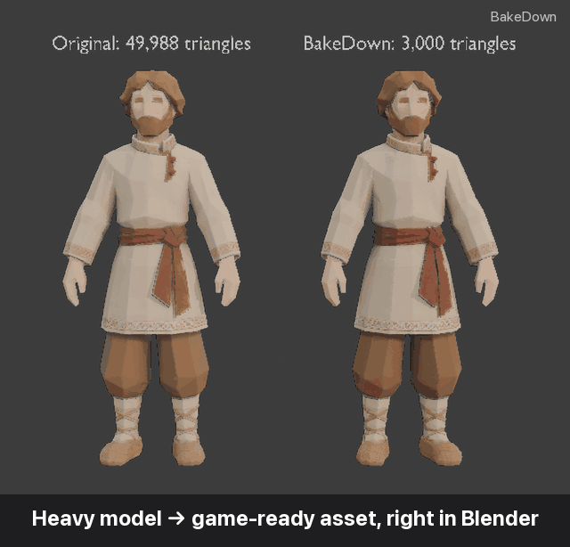
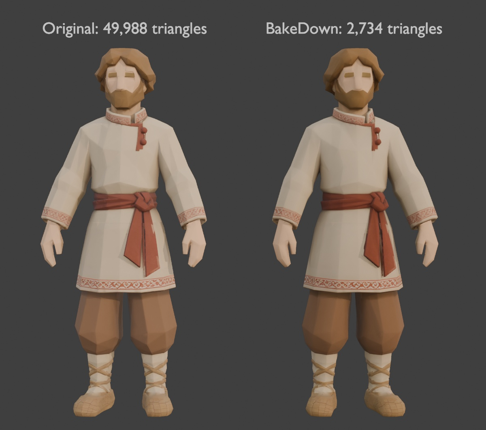
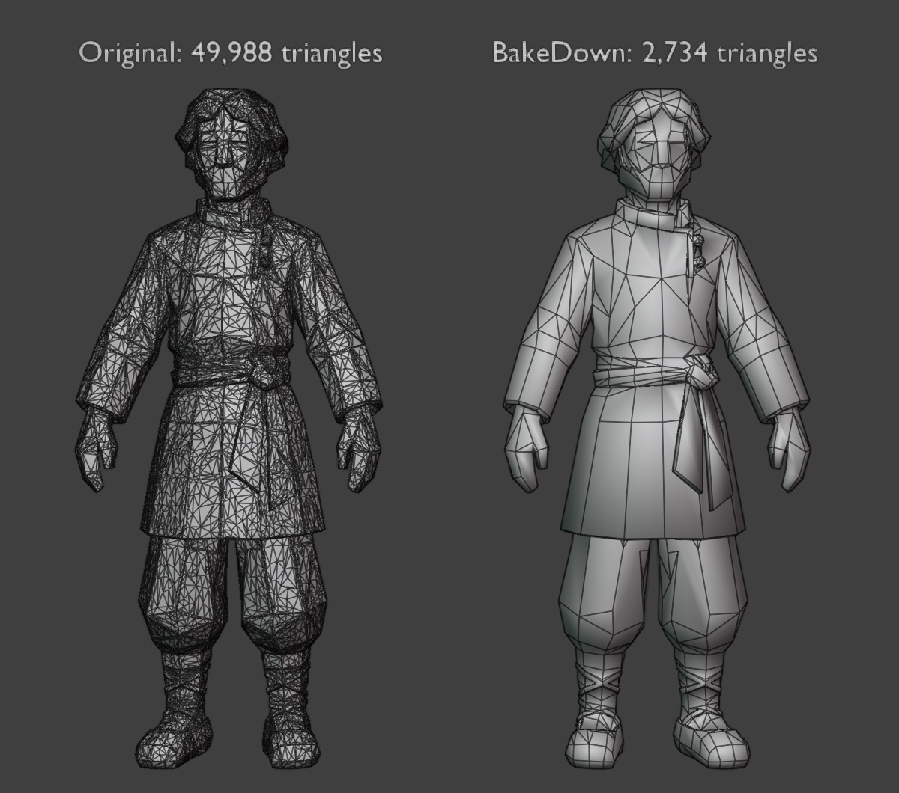
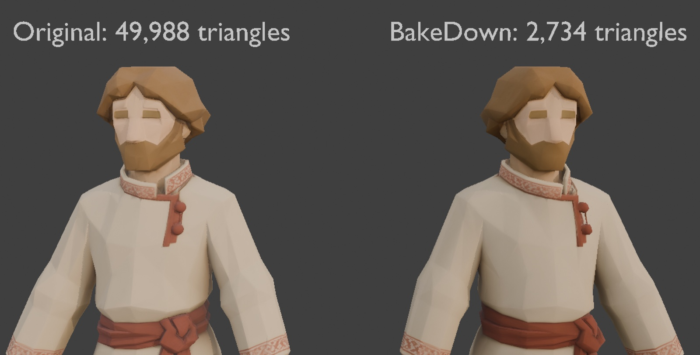
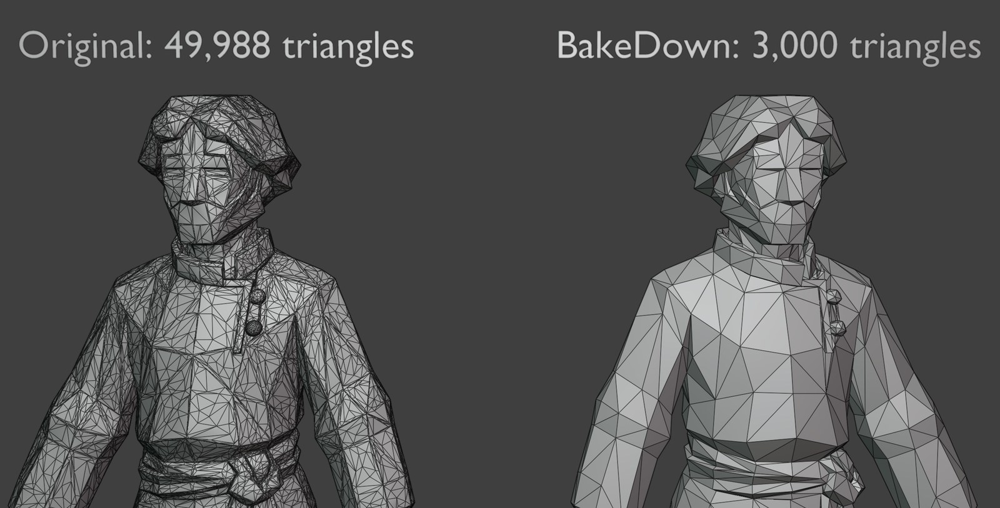

<div align="center">

# BakeDown

**Тяжёлые 3D-модели → игровые ассеты прямо в Blender.**

[English](README.md) · **Русский** · [Español](README.es.md) · [Deutsch](README.de.md) · [简体中文](README.zh-CN.md)

[](https://www.blender.org/download/)
[](https://github.com/keeraa/bakedown/releases/latest)
[](https://github.com/keeraa/bakedown/actions/workflows/tests.yml)
[](LICENSE)
[](#языки-интерфейса)
[](AGENTS.md)



**−95% треугольников · выглядит так же · PBR-текстуры запекаются за секунды**

[**⬇ Скачать**](https://github.com/keeraa/bakedown/releases/latest) · [▶ Демо на 40 секунд](docs/media/bakedown_demo.mp4) · [🤖 Для AI-агентов](AGENTS.md) · [❓ Вопросы и ответы](docs/FAQ.md)

</div>

---

BakeDown — бесплатный аддон для Blender, который превращает **любую тяжёлую модель** — из нейросетей (Hunyuan, Meshy, Tripo, Rodin), 3D-скан, скульпт, high-poly модель из маркетплейса или китбаша — в лёгкий текстурированный игровой ассет. Он упрощает меш, запекает на него текстуры оригинала, делает LOD, переносит риг и экспортирует в Unity, Unreal Engine или glTF. Работа недеструктивна: оригинал сохраняется, **Сброс** возвращает его.

## Быстрый старт

1. **Скачайте** `bakedown.py` из [последнего релиза](https://github.com/keeraa/bakedown/releases/latest).
2. В Blender: **Edit → Preferences → Add-ons → Install from Disk…**, выберите `bakedown.py`, включите **BakeDown — Game Asset Optimizer**.
3. Выделите модель, нажмите **N**, откройте вкладку **BakeDown**: **Упростить → Текстурировать → Экспорт**.

Персонажи: **Упростить → Текстурировать → Риг → LOD → Экспорт** (LOD после рига наследуют скелет).

## Почему BakeDown

| | Вручную в Blender | **BakeDown** |
|---|---|---|
| Сохранить оригинал и всё откатить | дублировать и следить самому | ✅ автоматическая копия, **Сброс** в один клик |
| Выбрать результат | угадывать коэффициент Decimate | ✅ цель по треугольникам **или** по допустимому искажению, в мм и % |
| Почистить AI-меш или скан | сварка, мусор, нормали, split-нормали вручную | ✅ встроено в **Упростить** |
| Сохранить внешний вид | настроить 4 запекания selected-to-active, UV, материалы | ✅ Base Color, Roughness, Metallic, Normal в один клик, откат при отмене |
| LOD | дублировать, упрощать, перепривязывать, переименовывать | ✅ пресеты LOD0–LOD3, общие текстуры, учёт скелета, предупреждение об устаревших LOD |
| Экспорт в движок | помнить оси, масштаб, сглаживание, формат нормалей | ✅ пресеты Unity / Unreal / glTF |
| Автоматизация | писать и отлаживать `bpy`-скрипты | ✅ Python API и командная строка с отчётом JSON |

Персонаж на 50 тысяч треугольников превращается в 2,7 тысячи с запеканием PBR 2K, четырьмя LOD и FBX для Unity **примерно за 5 секунд**.

## Сравните сами

| С текстурами | Сетка |
|---|---|
|  |  |
|  |  |

Оригинал (слева) и BakeDown (справа): 49 988 → 2 734 треугольника, искажение ≈7,3 мм (0,56%), запекание 4K.

## Что внутри

- **Упрощение** — цель по реальным треугольникам или по бюджету искажения, чистка AI-мешей и сканов, слияние плоских граней, коллапс; по желанию заполнение дыр, удаление внутренних граней, выравнивание, триангуляция. Меняется только активный меш.
- **Запекание** — Cycles-запекание Base Color, Roughness, Metallic и tangent Normal на новую UV-развёртку в 1K/2K/4K; авто-дистанция луча, живая сила рельефа, резкость; прогресс, отмена по Esc, полный откат.
- **LOD** — LOD0–LOD3 с пресетами Стратегия / 3D-шутер / Мобильные / Свой, один набор текстур, учёт скелета, имена `_LOD0…3` для LOD Group в Unity.
- **Перенос рига** — импорт заскиненного FBX-шаблона и перенос скелета и весов на активный меш.
- **Экспорт** — FBX для Unity, FBX для Unreal, самодостаточный GLB; PNG-карты рядом с моделью, упаковка ORM, инверсия нормалей в формат DirectX для Unreal.
- **Осмотр** — режим «Форма» (MatCap + каркас) и «Сравнить» оригинал ↔ результат.

## Работа с нейросетями (AI-агентами)

AI-агенты (Claude, ChatGPT, Codex, Blender MCP…) могут управлять BakeDown вместо того, чтобы сочинять собственный код для Blender: в тестах автора это давало заметно лучший результат. Оба способа возвращают отчёт в JSON (треугольники, искажение, запечённые карты, LOD, экспортированные файлы):

```bash
blender -b --factory-startup --python tools/bakedown_cli.py -- model.glb --out ./out --triangles 3000 --resolution 2048 --engine unity
```

```python
import bakedown
report = bakedown.process(obj, triangles=3000, resolution=2048, export_dir="/tmp/out", engine="UNITY")
```

Инструкция для агентов: [AGENTS.md](AGENTS.md).

## Языки интерфейса

Английский, русский, испанский, немецкий и упрощённый китайский — Blender переключает автоматически через **Preferences → Interface → Translation**.

## Вопросы и ответы

Цели по треугольникам, искажение, чёрные пятна после запекания, персонажи с ригом, особенности Unity и Unreal, ограничения: [docs/FAQ.md](docs/FAQ.md) (на английском).

## Участие в разработке

Сообщения об ошибках и идеи приветствуются — [создайте issue](https://github.com/keeraa/bakedown/issues/new/choose). Разработчикам: [CONTRIBUTING.md](CONTRIBUTING.md), [docs/DEVELOPMENT.md](docs/DEVELOPMENT.md), [docs/VERIFICATION.md](docs/VERIFICATION.md), [CHANGELOG.md](CHANGELOG.md).

## Лицензия

GPL-3.0-or-later © Kirill Migachev. См. [LICENSE](LICENSE).
