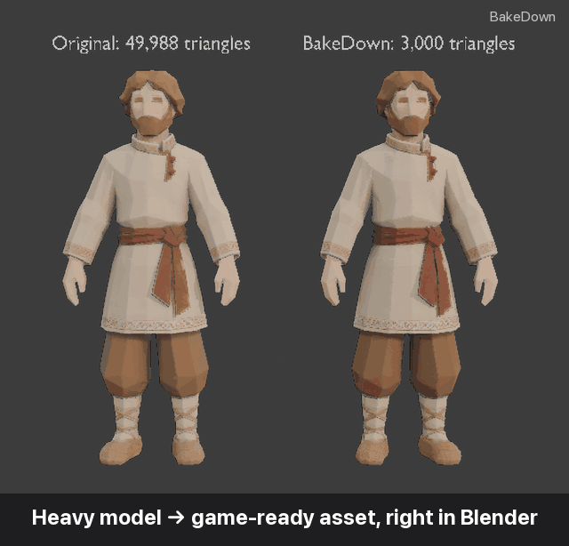
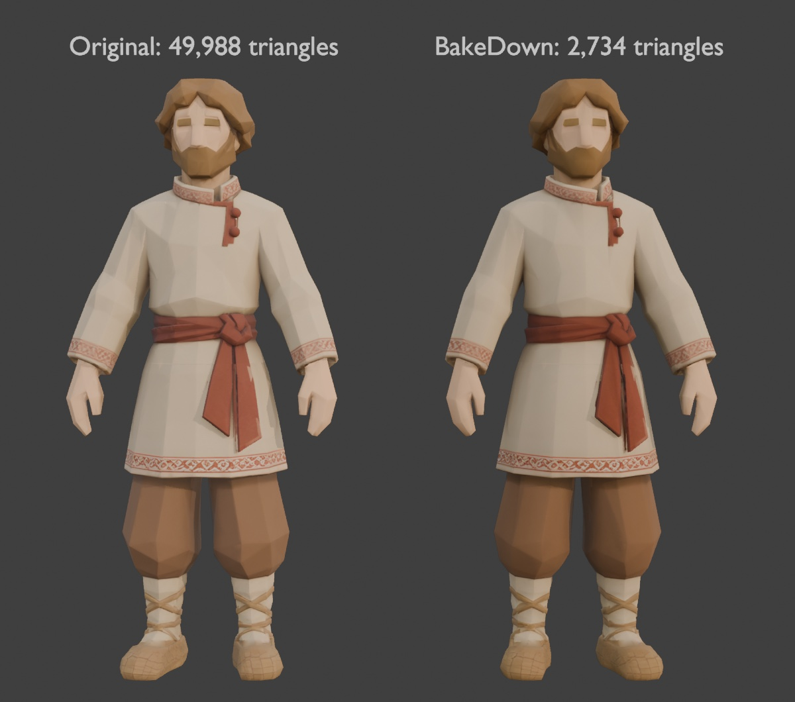
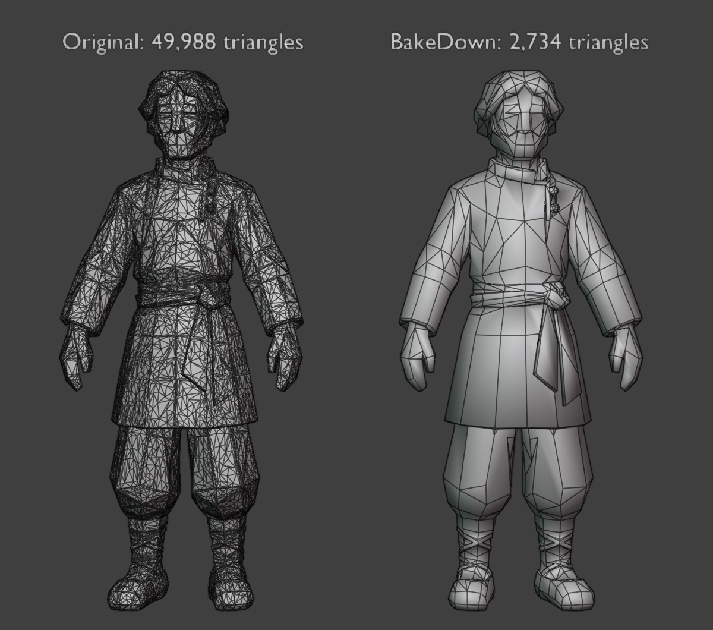
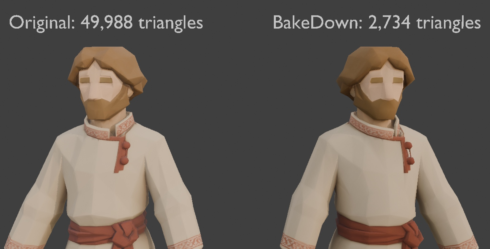
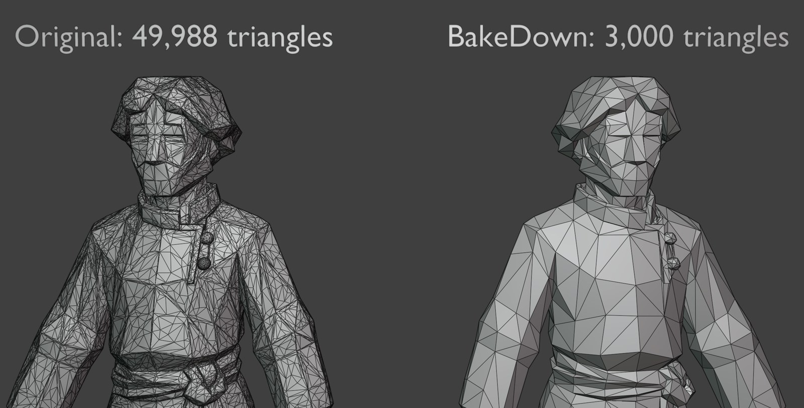

<div align="center">

# BakeDown

**高面数 3D 模型 → 可直接用于游戏的资产，就在 Blender 里完成。**

[English](README.md) · [Русский](README.ru.md) · [Español](README.es.md) · [Deutsch](README.de.md) · **简体中文**

[](https://www.blender.org/download/)
[](https://github.com/keeraa/bakedown/releases/latest)
[](https://github.com/keeraa/bakedown/actions/workflows/tests.yml)
[](LICENSE)
[](#界面语言)
[](AGENTS.md)



**三角面减少 94% · 外观不变 · 数秒完成 PBR 纹理烘焙**

[**⬇ 下载**](https://github.com/keeraa/bakedown/releases/latest) · [🤖 AI 智能体](AGENTS.md) · [❓ 常见问题](docs/FAQ.md)

</div>

---

BakeDown 是一款免费的 Blender 插件，可将**任何高面数网格**——AI 生成的模型（Hunyuan、Meshy、Tripo、Rodin）、3D 扫描、雕刻模型、素材商店或拼装（kitbash）的高模——转换为轻量、带纹理、可直接用于游戏的资产。它会简化网格、把原始模型的纹理烘焙到新网格上、生成 LOD、迁移骨骼绑定，并导出到 Unity、Unreal Engine 或 glTF。整个流程是非破坏性的：原始模型会被保留，**重置**即可恢复。

## 快速开始

1. 从[最新发布版](https://github.com/keeraa/bakedown/releases/latest)**下载** `bakedown.py`。
2. 在 Blender 中：**Edit → Preferences → Add-ons → Install from Disk…**，选择 `bakedown.py`，启用 **BakeDown — Game Asset Optimizer**。
3. 选中模型，按 **N**，打开 **BakeDown** 标签页：**简化 → 烘焙 → 导出**。

角色：**简化 → 烘焙 → 绑定 → LOD → 导出**（在绑定之后生成的 LOD 会继承骨架）。

## 为什么选择 BakeDown

| | 在 Blender 中手动操作 | **BakeDown** |
|---|---|---|
| 保留原始模型、随时撤销 | 自己复制并管理 | ✅ 自动备份，一键**重置** |
| 控制结果 | 猜测 Decimate 比例 | ✅ 按三角面数**或**允许的形状误差设定目标，以毫米和百分比显示 |
| 清理 AI 网格和扫描模型 | 手动合并顶点、清理游离部分、修复法线和自定义拆分法线 | ✅ 内置于**简化** |
| 保持外观 | 手动设置 5 次“选中到活动”烘焙、UV 和材质 | ✅ 一键烘焙 AO、基础色、糙度、金属度和法线，取消时自动回滚 |
| LOD | 复制、精简、重新绑定、重命名 | ✅ LOD0–LOD3 预设，共用纹理，支持骨架，过期 LOD 提醒 |
| 导出到引擎 | 记住坐标轴、缩放、平滑和法线格式 | ✅ Unity / Unreal / glTF 预设 |
| 自动化 | 编写并调试 `bpy` 脚本 | ✅ Python API 和命令行工具，输出 JSON 报告 |

一个 5 万面的角色，**约 7 秒**即可变为 3 千面，并完成 2K PBR 烘焙、四级 LOD 和 Unity FBX 导出。

质量靠测量而非目测：[`tools/quality_eval.py`](tools/quality_eval.py) 从四个方向渲染原始模型和结果，比较形状、颜色和轮廓。1.5 版将完整渲染误差在风格化角色上降低了 3–4 倍，在金属雕塑上降低了 10–40 倍——详见 [docs/VERIFICATION.md](docs/VERIFICATION.md)。

## 效果对比

| 带纹理 | 线框 |
|---|---|
|  |  |
|  |  |

原始模型（左）与 BakeDown（右）：49,988 → 3,000 个三角面，近似形变 1.8 mm（0.14%），4K 烘焙。

## 功能

- **简化** — 按实际三角面数或形变预算设定目标，清理 AI 网格和扫描模型，边塌陷精简，自动匹配原始模型的着色；可选填充孔洞、删除内部面、压平平面和三角化。只修改活动网格。
- **烘焙** — 使用 Cycles 将基础色、糙度、金属度、切线空间法线和环境光遮蔽烘焙到新的 UV 展开上，支持 1K/2K/4K；自动射线距离、实时法线强度、锐化；显示进度，按 Esc 取消，完整回滚。
- **LOD** — LOD0–LOD3，提供策略 / 3D 射击 / 移动端 / 自定义预设，共用一套纹理，支持骨架，`_LOD0…3` 命名可被 Unity 自动识别为 LOD Group。
- **绑定迁移** — 导入带蒙皮的 FBX 模板，把骨架和权重迁移到活动网格。
- **导出** — Unity 用 FBX、Unreal 用 FBX、独立 GLB；PNG 贴图保存在模型旁，支持带真实 AO 的 ORM 打包和 glTF 遮蔽贴图，为 Unreal 转换 DirectX 法线。
- **检查** — 形状模式（MatCap + 线框）以及原始 ↔ 结果对比。

## 配合 AI 智能体使用

AI 智能体（Claude、ChatGPT、Codex、Blender MCP 等）可以直接调用 BakeDown，而不必自行编写 Blender 代码；在作者的测试中，这样得到的资产明显更好。两种接入方式都会返回 JSON 报告（三角面数、形变、烘焙贴图、LOD、导出文件）：

```bash
blender -b --factory-startup --python tools/bakedown_cli.py -- model.glb --out ./out --triangles 3000 --resolution 2048 --engine unity
```

```python
import bakedown
report = bakedown.process(obj, triangles=3000, resolution=2048, export_dir="/tmp/out", engine="UNITY")
```

智能体说明：[AGENTS.md](AGENTS.md)（英文）。

## 界面语言

英语、俄语、西班牙语、德语和简体中文——Blender 会根据 **Preferences → Interface → Translation** 自动切换。

## 常见问题

三角面目标、形变、烘焙后出现黑斑、带绑定的角色、Unity 和 Unreal 的注意事项以及限制：[docs/FAQ.md](docs/FAQ.md)（英文）。

## 参与贡献

欢迎提交问题报告和建议——[创建 issue](https://github.com/keeraa/bakedown/issues/new/choose)。开发者请参阅：[CONTRIBUTING.md](CONTRIBUTING.md)、[docs/DEVELOPMENT.md](docs/DEVELOPMENT.md)、[docs/VERIFICATION.md](docs/VERIFICATION.md)、[CHANGELOG.md](CHANGELOG.md)。

## 许可证

GPL-3.0-or-later © Kirill Migachev。详见 [LICENSE](LICENSE)。
